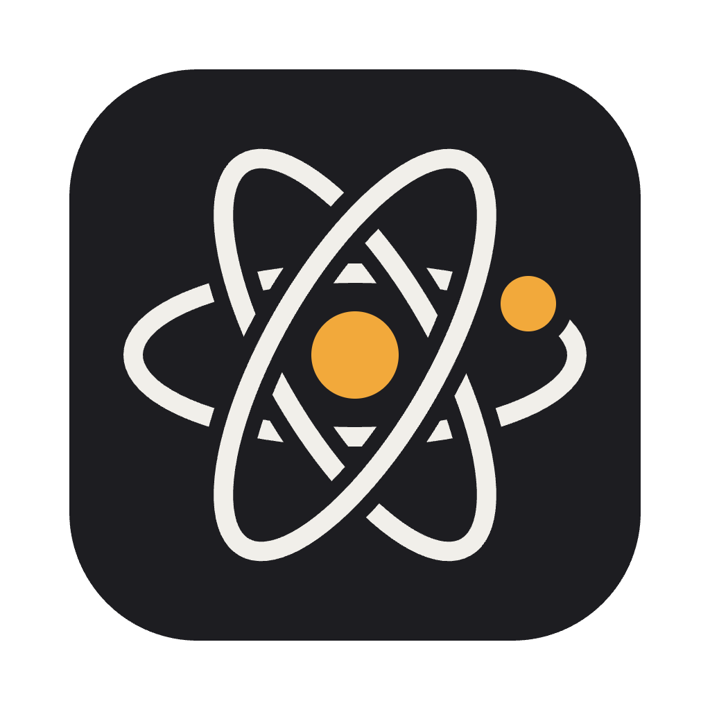
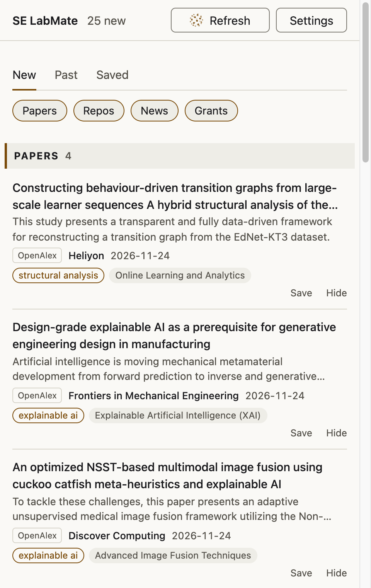
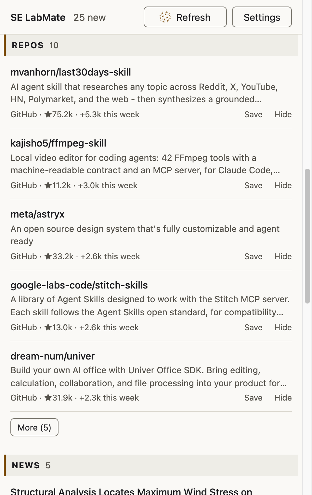
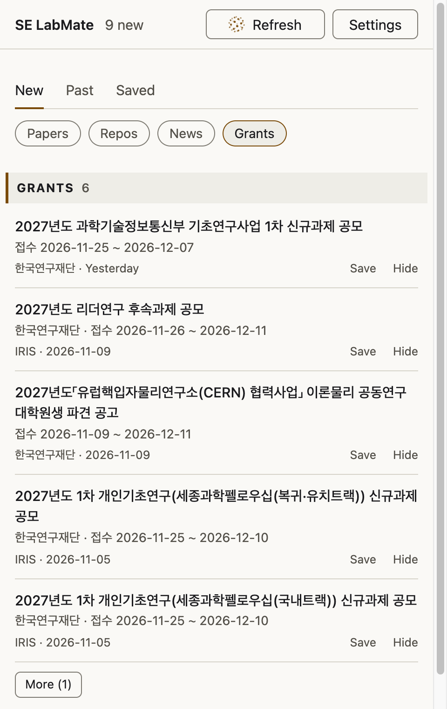
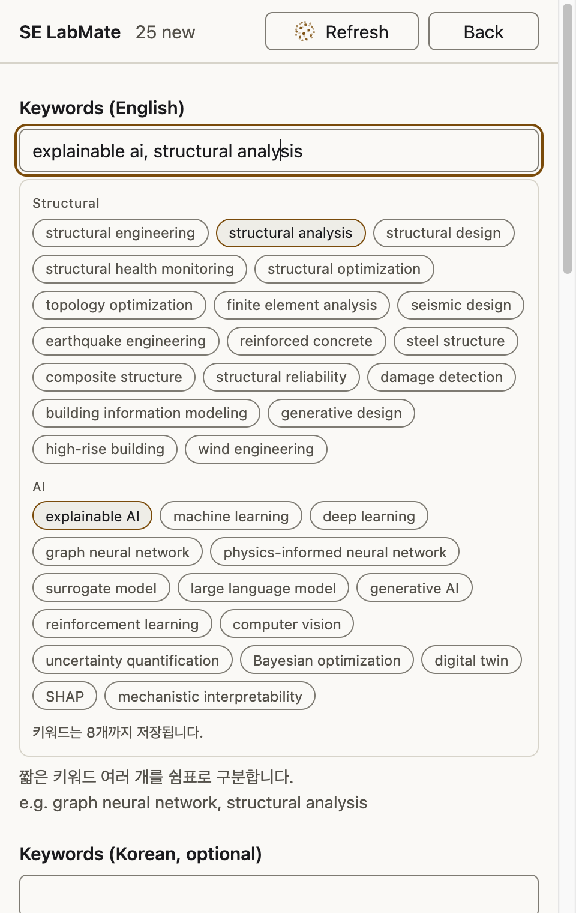

  

<h1 align="center">SE LabMate</h1>

  관심 분야의 새 논문, 인기 저장소, 뉴스, 과제 공고, 게시판 글을 한곳에 모아 
  정해 둔 시각에 알려 주는 데스크탑 앱입니다.

  
  

  
  
  

## 받기

**[최신 버전 받기](https://github.com/swon-nows/se-labmate/releases/latest)** 에서 컴퓨터에 맞는 파일을 고릅니다.

| 컴퓨터                       | 파일                        |
| ---------------------------- | --------------------------- |
| Windows                      | `se-labmate-버전-x64.exe`   |
| Mac (Apple Silicon, M1 이후) | `se-labmate-버전-arm64.dmg` |
| Mac (Intel)                  | `se-labmate-버전-x64.dmg`   |

서명을 받지 않은 시험판이라 처음 열 때 운영체제가 한 번 막습니다.

- **Windows**: SmartScreen 창에서 `추가 정보`를 누른 다음 `실행`을 누릅니다.
- **Mac**: 열리지 않으면 `시스템 설정 → 개인정보 보호 및 보안`에서 `그래도 열기`를 누릅니다.

## 시작하기

1. 앱을 열고 관심 키워드를 적습니다. 입력칸을 누르면 추천 키워드가 펼쳐집니다.
2. `Start`를 누르면 바로 소식을 모으기 시작합니다.
3. 창을 닫아도 앱은 트레이(메뉴 막대)에 남아, 정해 둔 시각에 새 소식이 있으면 알려 줍니다.

  

## 무엇을 모으나

| 묶음            | 내용                                                                                                          | 기준                                                                                                         |
| --------------- | ------------------------------------------------------------------------------------------------------------- | ------------------------------------------------------------------------------------------------------------ |
| **Papers**      | 새 논문. 제목 아래에 한 줄 요약, 출처, 저널명, 게재일자, 핵심 키워드가 함께 나옵니다.                         | 최근 30일 안에 나온 논문 중 제목이나 초록에 키워드가 있는 것 (OpenAlex, arXiv)                               |
| **Repos**       | GitHub에서 한 주 동안 별을 가장 많이 받은 저장소                                                              | 키워드와 무관. 개수는 설정에서 정합니다(기본 10개).                                                          |
| **News**        | 키워드가 들어간 뉴스                                                                                          | 최근 7일 (Google News)                                                                                       |
| **Grants**      | 접수 중이거나 접수 예정인 국내 연구과제 공고                                                                  | IRIS, 한국연구재단                                                                                           |
| **Conferences** | 고른 분야의 학회 소식. AI는 논문 마감이 90일 안으로 다가온 주요 학회, 구조공학은 학회의 행사와 논문 모집 공지 | `Settings`의 `Conference fields`에서 분야를 고릅니다. `Boards`에 학회 게시판 주소를 직접 넣을 수도 있습니다. |
| **School**      | 등록한 게시판의 새 글                                                                                         | `Settings`의 `Boards`에 학과 게시판 주소를 넣으면 됩니다.                                                    |

## 쓰는 법

- **New / Past / Saved**: `New`에는 아직 보지 않은 소식만 나옵니다. 한 번 본 소식은 `Past`로 옮겨지고, `Save`를 누른 것은 `Saved`에 모입니다.
- **카테고리 칩**: 위쪽의 `Papers`, `Repos` 같은 칩을 눌러 보고 싶은 묶음만 남길 수 있습니다.
- **Hide**: 관심 없는 항목은 `Hide`로 치웁니다.
- **Refresh**: 지금 바로 새 소식을 확인합니다.
- **알림**: 하루 한 번, `Settings`의 `Notify at`에 정한 시각에 새 소식이 있을 때만 알립니다.
- **업데이트**: 새 버전이 나오면 앱 위쪽에 알림이 뜹니다. `Update`를 누르면 설치 파일을 내려받아 설치를 시작합니다. Windows에서는 설치 뒤 앱이 다시 열리고, Mac에서는 열린 창에서 앱을 `Applications` 폴더로 끌어 놓으면 됩니다.

## 알아 둘 것

- **계정도 서버도 없습니다.** 설정과 모은 소식은 내 컴퓨터에만 저장됩니다.
- **OpenAlex 키는 선택입니다.** 키가 없으면 논문은 arXiv에서만 가져옵니다. 키는 무료이며 `Settings`의 `Get a key (free)`에서 발급 방법을 볼 수 있습니다.
- **한 줄 요약은 AI가 쓴 글이 아닙니다.** 초록에서 고른 한 문장이며, 초록이 공개되지 않은 논문에는 나오지 않습니다.
- **Region**: `Korea`를 고르면 한국어 뉴스와 국내 과제 공고도 가져오고, `Other`는 영문 소식만 가져옵니다.
